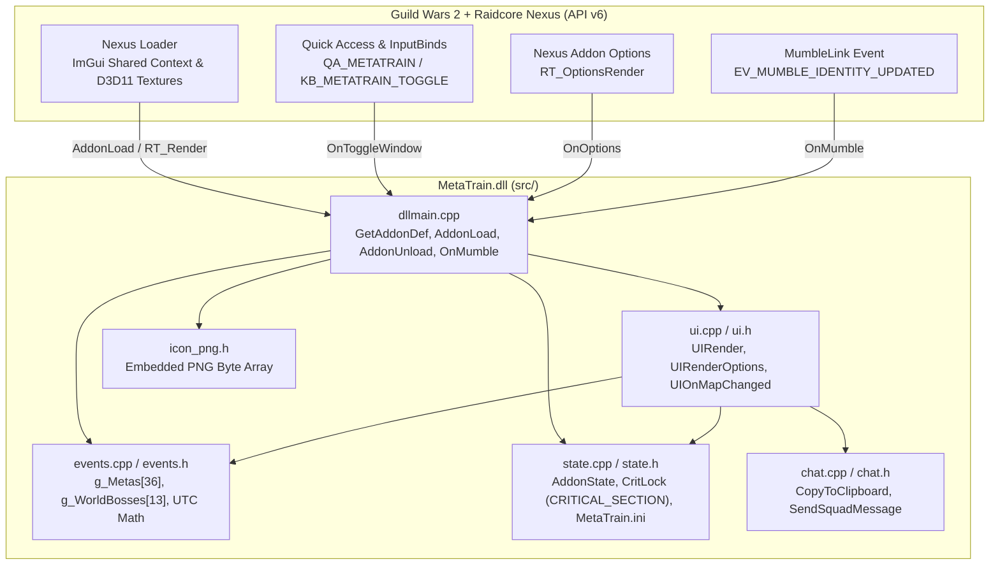

<p align="center">
  <a href="https://ko-fi.com/todd0042">
    
  </a>
</p>

---

# 🐉 Meta Train Commander (`gw2-meta-train`)

[](https://github.com/Todd0042/gw2-meta-train/releases)
[-orange.svg)](https://raidcore.gg/Nexus)
[]()
[]()
[](CMakeLists.txt)
[](https://ko-fi.com/todd0042)

> **Lead Guild Wars 2 meta-event and world-boss trains inside the Raidcore Nexus overlay — with UTC-synchronized countdowns across 49 events, gap-aware custom route planning, MumbleLink map auto-advance, and 1-click waypoint & `/d` squad announcement copying.**

<p align="center">
  
</p>

---

## 📖 Table of Contents

* **Part 1 — User Overview & Quick Start**
  * [🐉 What Is Meta Train Commander?](#-what-is-meta-train-commander)
  * [✨ Key Features](#-key-features)
  * [🧭 How It Works in 4 Steps](#-how-it-works-in-4-steps)
  * [🚀 Installation & Cross-Compile Build Instructions](#-installation--cross-compile-build-instructions)
* **Part 2 — Technical Architecture & Reference**
  * [1. System Architecture & Nexus Addon Lifecycle ([src/dllmain.cpp](src/dllmain.cpp), [Nexus.h](Nexus.h))](#1-system-architecture--nexus-addon-lifecycle)
  * [2. Event Database & UTC Timing Engine ([src/events.h](src/events.h), [src/events.cpp](src/events.cpp))](#2-event-database--utc-timing-engine)
  * [3. Overlay UI, Custom Run Builder & Schedule Planner ([src/ui.h](src/ui.h), [src/ui.cpp](src/ui.cpp))](#3-overlay-ui-custom-run-builder--schedule-planner)
  * [4. Persistent State & `MetaTrain.ini` Schema ([src/state.h](src/state.h), [src/state.cpp](src/state.cpp))](#4-persistent-state--metatrainini-schema)
  * [5. Clipboard & Squad Chat Helpers ([src/chat.h](src/chat.h), [src/chat.cpp](src/chat.cpp))](#5-clipboard--squad-chat-helpers)
  * [6. Build System, Embedded Assets & Cross-Compilation ([CMakeLists.txt](CMakeLists.txt), [build.sh](build.sh), [gen_icon.py](gen_icon.py))](#6-build-system-embedded-assets--cross-compilation)
  * [7. Repository Structure](#7-repository-structure)
  * [8. Verification & Build Audit](#8-verification--build-audit)
  * [9. AI Notice, Compliance & Support](#9-ai-notice-compliance--support)

---

# Part 1 — User Overview & Quick Start

## 🐉 What Is Meta Train Commander?

**Meta Train Commander** (`MetaTrain.dll`) is a native C++17 **Guild Wars 2** addon built for the **[Raidcore Nexus](https://raidcore.gg/Nexus)** overlay (`API v6`). Designed for squad commanders and event train organizers, it eliminates alt-tabbing to browser timers by putting live UTC event tracking, route chaining, waypoint links, and squad announcement helpers directly inside the game UI.

Instead of a static list of timers, Meta Train Commander pairs a **36-meta + 13-world-boss UTC timing engine** with an interactive **Build Your Run** planner and **MumbleLink** map-change awareness—automatically tracking your current stop, showing break windows between events, and unlocking the next waypoint and `/d` squad message right when it is time to move.

---

## ✨ Key Features

* **🕒 Live `NOW` & `NEXT` Commander HUD**: Displays the active event's elapsed progress bar, remaining max duration (or time until start), expansion-era color coding, a live UTC clock, and urgency-tinted countdowns to the next stop (`Cyan` ≥ 30m, `Yellow` < 30m, `Orange` < 15m, `Red` < 5m).
* **🗺️ 49 Tracked Events Across All GW2 Eras**: Covers **36 meta events** (Heart of Thorns, Living World Season 3, Path of Fire, Icebrood Saga / LW4–LW5, End of Dragons, Secrets of the Obscure, Janthir Wilds, and Visions of Eternity) plus **13 Core Tyria world bosses** (including 2-hour cycles, 3-hour cycles, and irregular daily UTC schedules for Tequatl, Triple Trouble, and Karka Queen).
* **🚂 Gap-Aware Custom Run Builder (`Build Your Run`)**: Chain up to `32` meta events in a custom train order. Once your plan has at least one event, the add-event dropdown automatically recalculates and sorts every remaining meta by **shortest gap after the end of your current chain**, making zero-downtime route building effortless.
* **💾 Up to 8 Named Saved Runs**: Save, load, and delete named route presets (e.g., `"HoT + EoD Loop"`), persisted across game restarts in `MetaTrain.ini`.
* **📅 21-Day `Schedule a Run` Future Planner**: Preview projected UTC start times, break indicators (`> 5 min`), per-row `[WP]` copy buttons, and total run duration for any date up to 21 days out—either for your active custom plan or all metas starting from a chosen stop.
* **⚡ Quick `Start Now` & Manual Controls**: Jump straight to whichever meta is currently active (or starting soonest) with **Start Now**, step manually with **`< Prev`** / **`Next >`**, or advance early with **`Finish Event ➡`** when a boss dies ahead of max timer.
* **🧭 MumbleLink Map Auto-Advance & `Ready to Move?` Banner**: Subscribes to `EV_MUMBLE_IDENTITY_UPDATED` to detect map transitions. When **Auto-Advance** is enabled and you enter the next event's map, the train advances automatically. If you stay on the same map for 15+ minutes while the next event isn't yet in its prep window, an optional **Ready to Move?** banner shows the exact countdown until travel time.
* **📋 Smart Waypoint & `/d` Announcement Unlocking**: `Copy WP` and `Copy /d Msg` unlock automatically once the current event starts or when the next event enters its prep window (`prepMinutes`). With **Auto-Announce** checked, `/d <squadMsg>` is automatically staged on your clipboard once per event at prep time.
* **🐉 Side-by-Side World Boss Fill Strip**: Always shows the next 3 soonest world bosses from `g_WorldBosses[]` with live active/upcoming timers and 1-click `Copy WP` buttons for filling downtime between major metas.

---

## 🧭 How It Works in 4 Steps

1. **Open the Overlay**: Click the **Meta Train Commander** icon on the Nexus Quick Access bar (or trigger your bound `KB_METATRAIN_TOGGLE` keybind in Nexus). The window starts hidden on launch so it never clutters your screen until you need it.
2. **Start a Quick Run or Build a Route**:
   * For ad-hoc commanding, click **`Start Now`** to lock onto the currently running (or soonest upcoming) meta.
   * For a planned train, pick events from the **Build Your Run** dropdown, click **`+ Add`** (repeating as desired up to 32 stops), optionally name and **`Save`** the preset, and hit **`► Start Run`**.
3. **Command Live**: Watch the **`NOW`** and **`NEXT`** panels. At `prepMinutes` before the next stop, **`► HEAD THERE NOW!`** lights up and **`Copy WP`** / **`Copy /d Msg`** unlock (or auto-copy if **Auto-Announce** is checked).
4. **Move & Auto-Advance**: Teleport to the next map—**Auto-Advance** detects your new `MapID` via MumbleLink and steps the train forward automatically (or click **`Finish Event ➡`** / **`Next >`** manually).

---

## 🚀 Installation & Cross-Compile Build Instructions

### Option A — Install Prebuilt DLL in Guild Wars 2 (Windows)

1. Install the **[Raidcore Nexus](https://raidcore.gg/Nexus)** addon manager/loader for Guild Wars 2.
2. Copy `MetaTrain.dll` into your Guild Wars 2 addons directory:
   ```text
   C:\Program Files\Guild Wars 2\addons\MetaTrain.dll
   ```
3. Launch Guild Wars 2. **Meta Train Commander** appears in your Nexus Addon List and adds its icon to the Quick Access toolbar.
4. *(Optional)* Bind a toggle hotkey to `KB_METATRAIN_TOGGLE` and customize defaults in **Nexus → Options → Meta Train Commander**.

### Option B — Build from Source (Linux → Windows x64 Cross-Compile)

The repository cross-compiles a standalone 64-bit Windows DLL (`build/MetaTrain.dll`) directly from Linux using `mingw-w64` and CMake, with ImGui `v1.80` and MinGW runtimes statically compiled so no extra runtime DLLs are required on Windows.

#### Prerequisites
```bash
# Arch / CachyOS
sudo pacman -S mingw-w64-gcc cmake python

# Debian / Ubuntu
sudo apt install mingw-w64 cmake python3
```

#### Build Commands
```bash
git clone https://github.com/Todd0042/gw2-meta-train.git
cd gw2-meta-train

# Standard release build (checks deps, configures CMake, builds, audits DLL imports)
./build.sh

# Clean rebuild from scratch
./build.sh --clean
```

`build.sh` outputs `build/MetaTrain.dll` and automatically runs `x86_64-w64-mingw32-objdump -p build/MetaTrain.dll | grep "DLL Name"` to verify clean Windows-only DLL dependencies.

---
---

# Part 2 — Technical Architecture & Reference

> *The sections below document the verified implementation of Meta Train Commander `v1.0.0` across all source files in `src/`, root headers, and CMake build scripts.*

---

## 1. System Architecture & Nexus Addon Lifecycle

Meta Train Commander is structured as a lightweight, lock-guarded C++17 DLL implementing the **Nexus API v6** contract ([Nexus.h](Nexus.h), [src/dllmain.cpp](src/dllmain.cpp)):



### Addon Export & Registration ([src/dllmain.cpp](src/dllmain.cpp))
* **Exported Descriptor (`GetAddonDef`)**: Returns `s_AddonDef` with:
  * `Signature`: `(uint32_t)(-0x4D54)` (`'MT'` negated)
  * `APIVersion`: `NEXUS_API_VERSION` (`6`)
  * `Name`: `"Meta Train Commander"`
  * `Version`: `{1, 0, 0, 0}`
  * `Author`: `"Todd0042"`
  * `UpdateProvider`: `UP_GitHub` (`https://github.com/Todd0042/gw2-meta-train`)
* **Startup (`AddonLoad`)**:
  1. Initializes event/state modules (`EventsInit()`, `StateInit()`) and loads `MetaTrain.ini` from `APIDefs->Paths_GetAddonDirectory("MetaTrain")`.
  2. Creates `g_AddonIcon` in memory via `APIDefs->Textures_GetOrCreateFromMemory("METATRAIN_ICON", icon_png, icon_png_len)`.
  3. Subscribes to `"EV_MUMBLE_IDENTITY_UPDATED"` (`OnMumble`).
  4. Registers `RT_Render` (`OnRender`) and `RT_OptionsRender` (`OnOptions`).
  5. Registers keybind `"KB_METATRAIN_TOGGLE"` and Quick Access shortcut `"QA_METATRAIN"`.
* **MumbleLink Garbage-Name Filtering (`OnMumble`)**:
  * At GW2 startup, `EV_MUMBLE_IDENTITY_UPDATED` can emit the executable path in `MumbleIdentity::Name` before character data is populated. `OnMumble()` rejects entries containing `\`, `/`, or `:`, ignores `MapID == 0`, deduplicates against `g_State.currentMapId`, and invokes `UIOnMapChanged(newMap)`.
* **Shutdown (`AddonUnload` & `DllMain`)**: Unsubscribes MumbleLink events, deregisters GUI callbacks, Quick Access icon, and input binds, and persists state via `StateSave(addonDir)`.

---

## 2. Event Database & UTC Timing Engine

All scheduling data and UTC time calculations live in [src/events.h](src/events.h) and [src/events.cpp](src/events.cpp). *(Note: An earlier prototype [events.cpp](events.cpp) remains at the repository root, but [CMakeLists.txt](CMakeLists.txt) compiles [src/events.cpp](src/events.cpp) into `MetaTrain.dll`.)*

### `MetaEvent` Data Model
Each entry in `g_Metas[]` and `g_WorldBosses[]` uses the `MetaEvent` struct:
* `name`, `mapName`, `mapId` (`uint32_t`, verified via `https://api.guildwars2.com/v2/maps`)
* `waypointCode` (in-game chat link, e.g., `"[&BN0HAAA=]"`) and `squadMsg` (e.g., `"Octovine (Battle in Tarir) » WP [&BN0HAAA=] | Auric Basin!"`)
* `durationMinutes` & `prepMinutes` (travel/auto-announce lead time)
* `expansion` (`EventExpansion`: `Core`, `HoT`, `PoF`, `IBS`, `EoD`, `SotO`, `JW`, `VoE`) & `category` (`WorldBoss` or `Meta`)
* Scheduling parameters: either uniform cycle (`intervalMinutes > 0`, `offsetMinutes`) or explicit daily UTC minute offsets (`intervalMinutes == 0`, `irregTimes[8]`, `irregCount`).

### Covered Event Inventory (`36` Metas + `13` World Bosses)

| Table | Category / Expansion | Count | Events Included |
| :--- | :--- | :---: | :--- |
| `g_WorldBosses` | **Core — 2h Cycle** | 4 | Svanir Shaman Chief (`120m/+15`), Fire Elemental (`120m/+45`), Great Jungle Wurm (`120m/+75`), Shadow Behemoth (`120m/+105`) |
| `g_WorldBosses` | **Core — 3h Cycle** | 6 | Taidha Covington (`180m/+0`), Megadestroyer (`180m/+30`), The Shatterer (`180m/+60`), Modniir Ulgoth (`180m/+90`), Golem Mark II (`180m/+120`), Claw of Jormag (`180m/+150`) |
| `g_WorldBosses` | **Core — Irregular UTC** | 3 | Tequatl the Sunless (`00:00, 03:00, 07:00, 11:30, 16:00, 19:00`), Triple Trouble (`01:00, 04:00, 08:00, 12:30, 17:00, 20:00`), Karka Queen (`02:00, 06:00, 10:30, 15:00, 18:00, 23:00`) |
| `g_Metas` | **Heart of Thorns (`HoT`) + LWS3** | 7 | Night Bosses, Chak Gerent, Octovine, Dragon's Stand, Saidra's Haven, New Loamhurst, Noran's Homestead *(LWS3 entries use `EventExpansion::HoT`)* |
| `g_Metas` | **Path of Fire (`PoF`)** | 10 | Casino Blitz, Buried Treasure, Path to Ascension, Doppelganger, Junundu Rising, Maws of Torment, Forged with Fire, Serpent's Ire, Palawadan, DB Shatterer |
| `g_Metas` | **Icebrood Saga (`IBS` / LW4–LW5)** | 6 | Thunderhead Keep, Oil Floes, Metal Concert, Drakkar, Twisted Marionette, Dragonstorm |
| `g_Metas` | **End of Dragons (`EoD`)** | 5 | Dragon's End, Aetherblade Assault, Kaineng Blackout, Gang War, Aspenwood |
| `g_Metas` | **Secrets of the Obscure (`SotO`)** | 3 | Wizard's Tower, Defense of Amnytas, Outer Nayos |
| `g_Metas` | **Janthir Wilds (`JW`)** | 3 | Of Mists and Monsters, A Titanic Voyage, Mount Balrior |
| `g_Metas` | **Visions of Eternity (`VoE`)** | 2 | Hammerhart Rumble!, Secrets of the Weald |

*(Note: In [src/ui.cpp](src/ui.cpp), the informational label in `UIRenderOptions()` currently prints `"19 meta events + 13 world bosses."`, reflecting an earlier count before the meta table was expanded to 36 entries.)*

### Scheduling Functions ([src/events.cpp](src/events.cpp))
* `SecondsUntilNext(ev, nowUtc)`: Returns `0` if the event is currently within `[start, start + durationMinutes * 60)`, otherwise seconds until the next UTC occurrence (`UniformSecsUntilNext` via modular cycle arithmetic, or `IrregSecsUntilNext` across daily UTC minute slots).
* `SecondsSinceLastStart(ev, nowUtc)`: Returns positive elapsed seconds when active, or `-SecondsUntilNext` when waiting.
* `NextOccurrenceAfter(ev, notBefore)`: Searches across today and tomorrow (`2` passes of `86400s`) for the first occurrence starting at or after `notBefore`.
* `GapSeconds(evA, aStart, evB)`: Computes downtime in seconds between the end of `evA` (`aStart + evA.durationMinutes * 60`) and the next start of `evB`.
* `ComputePlanSchedule(plan, planCount, fromTime, out)`: Chains a `plan[]` sequence of `g_Metas[]` indices forward from `fromTime`, populating `ScheduledOccurrence` (`eventIdx`, `startTime`, `endTime`, `gapBefore`) for the **Schedule a Run** table.

---

## 3. Overlay UI, Custom Run Builder & Schedule Planner

All ImGui rendering lives in [src/ui.cpp](src/ui.cpp) and [src/ui.h](src/ui.h):

* **Shared Nexus ImGui Context (`UIRender`)**: On the first rendered frame (`!g_State.imguiReady`), binds `ImGui::SetCurrentContext(APIDefs->ImGuiContext)` and `ImGui::SetAllocatorFunctions(APIDefs->ImGuiMalloc, APIDefs->ImGuiFree)` so heap allocations match Nexus's host ImGui instance.
* **Expansion Color Palette**: `EraAccents[8]` defines bright text and header background pairs for `Core`, `HoT`, `PoF`, `IBS`, `EoD`, `SotO`, `JW`, and `VoE` (using `static const ImVec4`, since `ImVec4` in ImGui 1.80 is non-literal).
* **Window Layout & Constraints**: Defaults to width `480` (`ImGuiCond_FirstUseEver`) with size constraints `{360, 220}` to `{900, FLT_MAX}`, `NoScrollbar | NoScrollWithMouse`, and dark translucent styling (`{0.07, 0.07, 0.09, 0.95}`).
* **Interactive Sections**:
  1. **Title Bar**: Addon icon (`20×20`), `META TRAIN COMMANDER`, and right-aligned UTC clock (`HH:MM UTC`).
  2. **`NOW` Panel**: Active meta header, map name, era tag, progress bar (`IN PROGRESS` or `Starts in`), **`Finish Event ➡`** (advances loop immediately when `loopActive`), and **`Copy /d Msg (this event)`**.
  3. **Break & Move Banners**: `##break` renders when `gapSec > 300` (`> 5` minutes); `##movebanner` renders when `loopActive && moveNotifyEnabled`, `secsOnMap >= 900` (`15+` min on same map), and `secsUntilNxt > prepMinutes * 60`.
  4. **`NEXT` Panel**: Shows next planned stop (when `loopActive && loopPlanCount > 0`) or soonest meta across `g_Metas[]`, urgency-colored countdown, **`► HEAD THERE NOW!`** / `Move in:`, and **`Copy WP`** + **`Copy /d Msg`** gated on `waypointUnlocked || secsUntilNxt < prepMinutes * 60`.
  5. **`WORLD BOSSES` Strip**: Insertion-sorts `g_WorldBosses[]` by `SecondsUntilNext` and renders the top 3 cards with countdowns and `Copy WP`.
  6. **`BUILD YOUR RUN` Panel**:
     * Displays numbered steps (`1..MAX_LOOP_PLAN` where `MAX_LOOP_PLAN = 32`) with per-row remove buttons (`x`) and green highlighting on the active `loopPlanPos`.
     * Dynamic **`##addev`** combo: sorts by time-until-start when empty, or simulates the end timestamp of the current plan chain and sorts candidates by `+gap` after the final event ends.
     * Controls: **`+ Add`**, **`Clear Plan`**, **`► Start Run`**, **`Start Now`**, **Saved Runs** (`Save`, `Load`, delete `x` across up to `8` slots), **`< Prev`**, **`Next >`**, **`Auto-Announce`**, and **`Auto-Advance`**.
  7. **`Upcoming` List**: Next 6 upcoming metas with inline `~~ <gap> break ~~` separators.
  8. **`Schedule a Run` Planner**: Expands on checkbox toggle; configures `schedDaysOffset` (`0–21`), `schedHour` (`0–23`), `schedMinute` (`0–59`, step 5/15), and `schedStartIdx`, then runs `ComputePlanSchedule()` (using `loopPlan` if non-empty, or all `g_MetaCount` events rotating from `schedStartIdx`).
  9. **Toast Bar**: Fades out `g_State.toastText` via `toastAlpha -= DeltaTime * 0.28f`.
* **Nexus Settings Tab (`UIRenderOptions`)**: Renders checkboxes for **Auto-Announce squad messages**, **Auto-advance loop on map change**, and **Ready-to-Move notifications**, saving immediately to `MetaTrain.ini`.

---

## 4. Persistent State & `MetaTrain.ini` Schema

Thread-safe state management is implemented in [src/state.h](src/state.h) and [src/state.cpp](src/state.cpp) using a Win32 `CRITICAL_SECTION` (`g_StateMutex`) wrapped by an RAII `CritLock` guard. `StateSave()` snapshots fields under lock before performing file I/O outside the lock, creating the target directory via `CreateDirectoryA(addonDir, nullptr)` if Nexus has not created it yet.

**Settings Path**: `<GW2>\addons\MetaTrain\MetaTrain.ini`

| Key | Type / Default | Description |
| :--- | :--- | :--- |
| `autoAnnounce` | `0` or `1` (`0`) | Automatically copies `/d <squadMsg>` to clipboard once per event when `secsUntilNext <= prepMinutes * 60`. |
| `autoAdvanceOnMap` | `0` or `1` (`1`) | Advances `currentIdx` / `loopPlanPos` when `EV_MUMBLE_IDENTITY_UPDATED` reports entering the next event's `mapId`. |
| `moveNotify` | `0` or `1` (`1`) | Enables the cyan `Ready to move the train?` banner after `900s` on the same map. |
| `startIdx` | `int` (`0`) | Last manually or run-started `g_Metas[]` index, restored as `currentIdx` and `loopStartIdx` on load. |
| `planCount` | `0..32` (`0`) | Number of stops in the active custom `loopPlan[]`. |
| `plan` | comma-separated ints | Ordered `g_Metas[]` indices for the active custom plan. |
| `numSavedRuns` | `0..8` (`0`) | Number of occupied `SavedRun` preset slots (`MAX_SAVED_RUNS = 8`). |
| `run<r>Name` | string (max 31 chars) | Display name for saved run slot `r` (`0..7`). |
| `run<r>N` | `0..32` | Event count in saved run slot `r`. |
| `run<r>` | comma-separated ints | Ordered `g_Metas[]` indices for saved run slot `r`. |

---

## 5. Clipboard & Squad Chat Helpers

Implemented in [src/chat.h](src/chat.h) and [src/chat.cpp](src/chat.cpp):

* **`CopyToClipboard(const char* text)`**: Allocates movable global memory (`GlobalAlloc(GMEM_MOVEABLE, len)`) and writes `CF_TEXT` to the Windows clipboard for 1-click waypoint links (`[&...]`) and `/d` squad messages.
* **`SendSquadMessage(const char* msg)`**: Implements direct Win32 `SendInput` automation—locating the GW2 window (`ArenaNet_Dx_Window_Class` or `"Guild Wars 2"`), verifying `GetForegroundWindow() == gw2`, staging `/d <msg>` on the clipboard, and sending `Enter` → `Ctrl+A` → `Ctrl+V` → `Enter` (pasting avoids stray `WASD` character movement while the chat box opens). In the current `v1.0.0` UI ([src/ui.cpp](src/ui.cpp)), both manual buttons and `TickAutoAnnounce()` call `CopyToClipboard()` rather than `SendSquadMessage()`.

---

## 6. Build System, Embedded Assets & Cross-Compilation

* **[CMakeLists.txt](CMakeLists.txt)**:
  * Targets C++17 (`CMAKE_CXX_STANDARD 17`), outputs `MetaTrain.dll` (`PREFIX ""`, `SUFFIX ".dll"`), and sets `_WIN32_WINNT=0x0A00`, `WIN32_LEAN_AND_MEAN`, and `NOMINMAX`.
  * Compiles ImGui `v1.80` sources (`imgui.cpp`, `imgui_draw.cpp`, `imgui_tables.cpp`, `imgui_widgets.cpp` from [imgui/](imgui/)) directly into the DLL target so cross-compilation succeeds without a Nexus `.lib` import library, while runtime calls use Nexus's shared ImGui context.
  * Statically links MinGW runtime libraries (`-static-libgcc`, `-static-libstdc++`, `-Wl,-Bstatic,--whole-archive,-lwinpthread,--no-whole-archive`) to prevent Windows `LoadLibrary` Error 126 on clean GW2 installations.
* **[toolchain-mingw.cmake](toolchain-mingw.cmake)**: Configures CMake for Windows targeting `x86_64-w64-mingw32-gcc`, `x86_64-w64-mingw32-g++`, and `x86_64-w64-mingw32-windres`.
* **[build.sh](build.sh)**: Checks for `cmake`, `x86_64-w64-mingw32-g++`, and `imgui/imgui.cpp`, supports `--clean`, runs Release CMake configure & parallel build (`-j"$(nproc)"`), and prints the DLL import table via `x86_64-w64-mingw32-objdump`.
* **[gen_icon.py](gen_icon.py)**: Converts [icon.png](icon.png) into the C byte array header [src/icon_png.h](src/icon_png.h) (`icon_png[]`, `icon_png_len`) embedded directly in `MetaTrain.dll`.

---

## 7. Repository Structure

```text
gw2-meta-train/
├── CMakeLists.txt             # CMake build definition (C++17, static MinGW runtimes, MetaTrain.dll)
├── toolchain-mingw.cmake      # Linux → Windows x64 MinGW-w64 CMake toolchain file
├── build.sh                   # Prerequisite check, Release build & objdump DLL import audit
├── gen_icon.py                # Converts icon.png into embedded C byte array (src/icon_png.h)
├── Nexus.h                    # Raidcore Nexus API v6 header (AddonAPI_t, AddonDefinition_t, MumbleLink)
├── mumble.h                   # Minimal MumbleLink compatibility wrapper including Nexus.h
├── icon.png                   # Source addon icon PNG (9,082 bytes)
├── Meta-Train.txt             # Reference 27-stop core Meta Train event order list
├── User_Instructions.txt      # Legacy end-user guide (reflects earlier 35-event UI iteration)
├── event_tracks.json          # Reference GW2 event timer JSON (note: +60m offset bias per src/events.cpp)
├── events.cpp                 # Earlier root-level event prototype (not compiled by CMakeLists.txt)
├── imgui/                     # Dear ImGui v1.80 headers & core sources compiled into the DLL
│   ├── imconfig.h
│   ├── imgui.h / imgui.cpp
│   ├── imgui_draw.cpp
│   ├── imgui_tables.cpp
│   ├── imgui_widgets.cpp
│   ├── imgui_internal.h
│   └── imstb_*.h
└── src/                       # Compiled addon source files
    ├── dllmain.cpp            # GetAddonDef, DllMain, AddonLoad/Unload, OnMumble, Quick Access & keybind
    ├── events.h / events.cpp  # MetaEvent table (36 metas + 13 world bosses) & UTC scheduling math
    ├── state.h / state.cpp    # Thread-safe AddonState, CritLock, & MetaTrain.ini persistence
    ├── ui.h / ui.cpp          # ImGui overlay panels, Build Your Run, Schedule a Run & Nexus Options
    ├── chat.h / chat.cpp      # Windows CF_TEXT clipboard helper & Win32 SendInput squad chat helper
    ├── icon.png               # Copy of addon icon PNG
    └── icon_png.h             # Auto-generated embedded icon byte array
```

---

## 8. Verification & Build Audit

There is no automated unit-test suite in this repository; verification is performed via cross-compilation, DLL import auditing, and in-game Nexus testing:

1. **Cross-Compile & Clean Import Audit**:
   ```bash
   ./build.sh --clean
   ```
   Confirm `build/MetaTrain.dll` builds cleanly with zero errors and that the trailing `x86_64-w64-mingw32-objdump -p build/MetaTrain.dll | grep "DLL Name"` output lists only standard Windows system DLLs (`KERNEL32.dll`, `USER32.dll`, `api-ms-win-crt-*.dll`) and **no** `libwinpthread-1.dll`, `libgcc_s_seh-1.dll`, or `libstdc++-6.dll`.
2. **In-Game Nexus Verification**:
   * Copy `build/MetaTrain.dll` to `<GW2>\addons\MetaTrain.dll` and confirm **Meta Train Commander** loads cleanly in Nexus (`API v6`).
   * Verify Quick Access icon (`QA_METATRAIN`) and `KB_METATRAIN_TOGGLE` toggle the overlay, `MetaTrain.ini` is created under `<GW2>\addons\MetaTrain\MetaTrain.ini`, and waypoint/map-ID behavior matches the current GW2 build (for events with `mapId == 0` in `src/events.cpp`, `Auto-Advance` cannot match by map ID until populated from `https://api.guildwars2.com/v2/maps`).
3. **Regenerating the Embedded Icon** *(if `icon.png` is modified)*:
   ```bash
   python3 gen_icon.py
   ./build.sh
   ```

---

## 9. AI Notice, Compliance & Support

### 🤖 AI Notice
This addon includes AI-generated content and/or AI-assisted code.

AI may have been used during development for tasks such as code generation, suggestions, documentation, or content creation. While efforts are made to review and validate all AI-generated output, it may not always be fully accurate, optimal, or free of unintended behavior.

Users should be aware that:
* AI-generated components may contain errors or inconsistencies or may be unstable.
* Behavior may change as the addon evolves or is updated.
* The developer remains responsible for ensuring compliance with the game's Terms of Service.

### ⚖️ Repository Licensing & Third-Party Notices
* No dedicated `LICENSE` file is currently present in this repository; contact the repository owner ([Todd0042](https://github.com/Todd0042)) regarding reuse or redistribution terms.
* **Dear ImGui (`imgui/`)** is copyright Omar Cornut and contributors; **Raidcore Nexus API (`Nexus.h`)** is part of the [Raidcore Nexus](https://raidcore.gg/Nexus) ecosystem.

---

<p align="center">
  If Meta Train Commander helps you lead smoother GW2 meta trains, consider supporting development:<br/><br/>
  <a href="https://ko-fi.com/todd0042" target="_blank">
    
  </a>
</p>

---

<p align="center">
  <a href="https://ko-fi.com/todd0042">
    
  </a>
</p>
